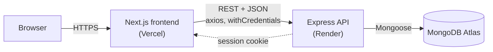
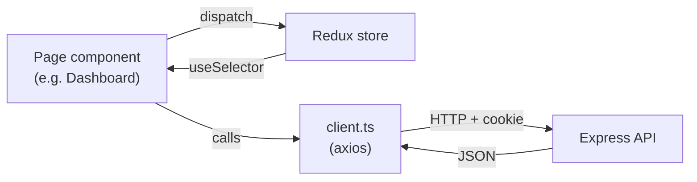

# Kambaz (Next.js)

The frontend for **Kambaz**, a Canvas-style learning management system with courses, modules, assignments, people, grades and quizzes. It's built with Next.js 16, React 19, Redux Toolkit and React-Bootstrap. The backend API is [kambaz-node-server-app-quiz](https://github.com/kashyap03042003/kambaz-node-server-app-quiz).

- **Deployed frontend:** https://kambaz-next-js-quiz.vercel.app
- **Deployed API:** https://kambaz-node-server-app-quiz-7l9y.onrender.com

## Features

- **Account:** sign in, sign up and profile. Admins also get a **Users** page for managing users.
- **Dashboard:** your enrolled courses. Faculty can add, edit and delete courses. Anyone can switch to the **Enrollments** view to enroll in or drop courses.
- **Course pages:** Home, Modules, Assignments, Quizzes, People, Grades, Piazza and Zoom.
- **Quizzes:** faculty create, edit and preview quizzes. Students take them and see their scores.

### Roles

| Role | Can do |
|---|---|
| `FACULTY` | Create and edit courses, modules, assignments and quizzes |
| `STUDENT` | View enrolled courses and take quizzes |
| `ADMIN` | Manage users on the Account → Users page |

## High-level architecture



The system has three tiers:

1. **Frontend (this repo).** A Next.js App Router app on Vercel. Pages are client components that render with React-Bootstrap.
2. **API** ([kambaz-node-server-app-quiz](https://github.com/kashyap03042003/kambaz-node-server-app-quiz)). An Express server on Render that handles authentication and CRUD for users, courses, modules, assignments, enrollments and quizzes.
3. **Database.** MongoDB Atlas, used only by the API.

### Inside the frontend



| Layer | Where | Job |
|---|---|---|
| Pages and layouts | `app/(Kambaz)/**/page.tsx`, `layout.tsx` | UI and routing. `Courses/[cid]/layout.tsx` adds the course sidebar. |
| State | `store.ts` plus feature `reducer.ts` files | Redux slices: `accountReducer` (current user), `coursesReducer`, `modulesReducer`, `assignmentsReducer` and `enrollmentsReducer` |
| API clients | `client.ts` in each feature | axios calls to `NEXT_PUBLIC_HTTP_SERVER` with `withCredentials: true` |

### A typical flow: sign in, then see your courses

1. **Signin** calls `POST /api/users/signin`. The API stores the user in its session and sets the session cookie.
2. The returned user is saved to `accountReducer.currentUser`.
3. **Dashboard** calls `GET /api/users/:uid/courses` and puts the result in `coursesReducer`.
4. Components read `currentUser.role` to decide what to show. For example, `FACULTY` gets the add, edit and delete controls.

Edit permissions are checked in the UI only. The API itself just limits what admins and students get back: admins get all courses, and students get only published quizzes.

## Getting started

### 1. Start the backend first

Follow the setup in the [server README](https://github.com/kashyap03042003/kambaz-node-server-app-quiz). By default it runs on `http://localhost:4000`.

### 2. Install and configure

```bash
npm install
```

Create `.env.development` (or `.env.local`):

```env
NEXT_PUBLIC_HTTP_SERVER=http://localhost:4000
```

### 3. Run

```bash
npm run dev
```

Open http://localhost:3000/Account/Signin.

## Scripts

| Command | Description |
|---|---|
| `npm run dev` | Dev server (Turbopack) |
| `npm run build` | Production build |
| `npm start` | Serve the production build |
| `npm run lint` | ESLint |

## Project structure

```
app/(Kambaz)/
  Account/        Signin, Signup, Profile, Users (admin)
  Dashboard/      Course cards, add/edit courses, enrollment toggle
  Courses/[cid]/  Home, Modules, Assignments, Quizzes, People, Grades, ...
  Calendar/  Inbox/
  store.ts        Redux store
public/images/    Course card images
```

API calls live in each feature's `client.ts` and use axios with `withCredentials: true`, so the session cookie is sent.

## Deploying to Vercel

1. Import this repo into Vercel.
2. Set `NEXT_PUBLIC_HTTP_SERVER` to the Render API URL, with no trailing slash, then redeploy.
3. On the server's Render service, set `CLIENT_URL` to this Vercel URL so that CORS and cookies work.
